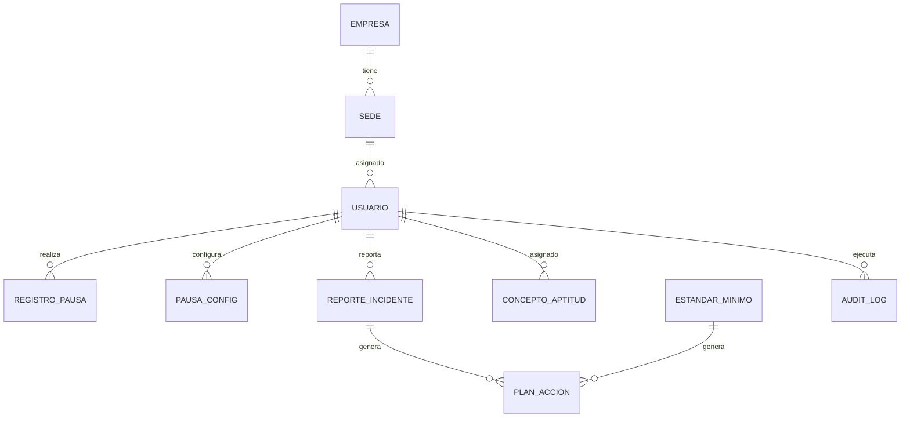

# Arquitectura de Datos, RBAC, Privacidad y Plan de Pruebas — SafePulse SST

**Documento:** `docs/adr/0002-modelo-datos-mvp.md`  
**Estado:** Propuesto (Esperando aprobación en Punto de Control B)  
**Fecha:** 2026-11-18  
**Autor:** Equipo de Arquitectura SG-SST  

---

## 1. Modelo de Dominio y Esquema Relacional del MVP

El esquema está diseñado para **Prisma ORM** con soporte para **PostgreSQL** y **SQLite** (en desarrollo y pruebas locales rápidas). Cumple con el principio de identificadores UUID, trazabilidad inmutable y aislamiento estricto de datos de salud.

### Definición de Entidades Principales

#### 1.1. Organización y Accesos
* **`Empresa`**: `id` (UUID), `nit` (String), `razon_social` (String), `clase_riesgo` (Int: 1 a 5), `num_trabajadores` (Int), `creado_en` (DateTime).
* **`Sede`**: `id` (UUID), `empresa_id` (UUID FK), `nombre` (String), `ciudad` (String), `direccion` (String).
* **`Usuario`**: `id` (UUID), `sede_id` (UUID FK), `nombre` (String), `email` (String único), `password_hash` (String), `rol` (Enum: `COLABORADOR`, `LIDER_SST`, `GERENCIA`, `COPASST`), `activo` (Boolean), `creado_en` (DateTime).

#### 1.2. Módulo de Pausas Activas ("Pausa Vital")
* **`PausaConfig`**: `id` (UUID), `usuario_id` (UUID FK único), `frecuencia_minutos` (Int: defecto 60), `sonido_activo` (Boolean), `notificaciones_activas` (Boolean).
* **`RegistroPausa`**: `id` (UUID), `usuario_id` (UUID FK), `tipo_ejercicio` (Enum: `VISUAL_20_20`, `CUELLO_TRAPECIO`, `TUNEL_CARPIANO`, `LUMBAR_POSTURAL`), `duracion_segundos` (Int), `completada_en` (DateTime).

#### 1.3. Reporte de Incidentes y Eventos
* **`ReporteIncidente`**: `id` (UUID), `radicado` (String único: ej. `REP-2026-0001`), `sede_id` (UUID FK), `reportado_por_id` (UUID FK nullable para opción anónima), `tipo_evento` (Enum: `INCIDENTE`, `CONDICION_INSEGURA`, `ACTO_INSEGURO`), `descripcion` (Text), `ubicacion_especifica` (String), `foto_url` (String nullable), `estado` (Enum: `REPORTADO`, `EN_INVESTIGACION`, `GESTIONADO`, `CERRADO`), `fecha_ocurrencia` (DateTime), `creado_en` (DateTime), `sincronizado_en` (DateTime).

#### 1.4. Salud Laboral (Resolución 1843 de 2025 — Estricta Reserva)
* **`ConceptoAptitudMedica`**: `id` (UUID), `usuario_id` (UUID FK), `tipo_evaluacion` (Enum: `PREINGRESO`, `PERIODICA`, `EGRESO`, `CAMBIO_OCUPACION`, `POST_INCAPACIDAD`, `RETORNO`, `SEGUIMIENTO`), `fecha_expedicion` (Date), `fecha_vencimiento` (Date), `concepto` (Enum: `APTO`, `APTO_CON_RECOMENDACIONES`, `APTO_CON_RESTRICCIONES`, `NO_APTO_TEMPORAL`, `NO_APTO_DEFINITIVO`), `recomendaciones_laborales` (Text — pautas ergonómicas/operativas), `ips_emisora` (String), `medico_licencia_sst` (String).
  > **Nota de seguridad:** CERO campos para diagnósticos médicos, anamnesis ni historias clínicas.

#### 1.5. Estándares Mínimos (Resolución 0312 de 2019)
* **`EstandarMinimo`**: `id` (UUID), `empresa_id` (UUID FK), `codigo_norma` (String: ej. `1.1.1`, `2.1.1`), `fase_phva` (Enum: `PLANEAR`, `HACER`, `VERIFICAR`, `ACTUAR`), `descripcion` (Text), `peso_porcentual` (Float), `calificacion` (Enum: `CUMPLE_TOTAL`, `NO_CUMPLE`, `NO_APLICA_JUSTIFICADO`), `justificacion_no_aplica` (Text nullable), `actualizado_en` (DateTime).

#### 1.6. Plan de Acción y Hallazgos
* **`PlanAccion`**: `id` (UUID), `origen_tipo` (Enum: `INCIDENTE`, `ESTANDAR_MINIMO`, `INSPECCION`), `origen_id` (UUID), `descripcion_hallazgo` (Text), `accion_propuesta` (Text), `responsable_id` (UUID FK), `fecha_limite` (Date), `estado` (Enum: `ABIERTA`, `EN_EJECUCION`, `CERRADA_EFICAZ`), `fecha_cierre` (DateTime nullable), `verificado_por_id` (UUID FK nullable).

#### 1.7. Registro de Auditoría Inmutable
* **`RegistroAuditoria`**: `id` (UUID), `usuario_id` (UUID FK nullable para anónimos), `accion` (Enum: `CREAR`, `ACTUALIZAR`, `CAMBIAR_ESTADO`, `CALIFICAR`), `entidad` (String: `ReporteIncidente`, `ConceptoAptitud`, `EstandarMinimo`, `PlanAccion`), `entidad_id` (UUID), `valores_anteriores` (Text JSON nullable), `valores_nuevos` (Text JSON nullable), `ip_origen` (String), `creado_en` (DateTime por defecto `now()`).
  > **Regla de base de datos:** Solo permite operaciones `INSERT`. Ningún usuario puede ejecutar `UPDATE` o `DELETE`.

---

## 2. Matriz Técnica de Permisos por Rol (RBAC)

| Entidad / Endpoint | Público | Colaborador | Líder SST (Admin) | Gerencia | COPASST / Vigía |
|---|:---:|:---:|:---:|:---:|:---:|
| `GET /api/portal/info` | Permitido | Permitido | Permitido | Permitido | Permitido |
| `POST /api/pausas/completar` | Denegado | Propio | Propio | Propio | Propio |
| `POST /api/incidentes/reportar` | Permitido (Anónimo) | Permitido | Permitido | Denegado | Permitido |
| `GET /api/incidentes/lista` | Denegado | Propios | Todos (Sede) | Solo lectura | Lectura investigación |
| `POST /api/aptitud/registrar` | Denegado | Denegado | Permitido | Denegado | Denegado |
| `GET /api/aptitud/mis-recomendaciones`| Denegado | Propio | Propios | Propios | Denegado |
| `GET /api/aptitud/lista-general` | Denegado | Denegado | Todos (Sede) | Consolidado sin nombres | Denegado |
| `POST /api/estandares/calificar` | Denegado | Denegado | Permitido | Denegado | Denegado |
| `GET /api/tablero/indicadores` | Denegado | Denegado | Permitido | Permitido | Permitido |
| `POST /api/acciones/cerrar` | Denegado | Denegado | Permitido | Denegado | Denegado |
| `GET /api/auditoria/log` | Denegado | Denegado | Solo lectura | Solo lectura | Denegado |

---

## 3. Tratamiento de Datos Sensibles y Privacidad (Habeas Data)

1. **Aislamiento de Salud Laboral:** Los conceptos de aptitud no se mezclan con los datos operativos.
2. **Minimización de Datos:** En el reporte de incidentes, el trabajador afectado solo se referencia por su identificador laboral; no se solicitan datos médicos ni antecedentes.
3. **Evidencias Multimedia Seguras:** Las fotografías adjuntas en reportes no deben exponer rostros de terceros lesionados; la aplicación incluye advertencia visual de privacidad antes de subir la imagen.
4. **Protección en Logs del Sistema:** Prohibición absoluta de serializar nombres completos o recomendaciones de salud en la salida de consola, logs de Winston/Pino o URLs.

---

## 4. Plan de Pruebas de Cálculos Normativos y Permisos

### 4.1. Cálculos Normativos (Casos Dorados)
* **Prueba CN-001 (Autoevaluación Res. 0312):**
  * *Entrada:* Planear (20/25), Hacer (50/60), Verificar (5/5), Actuar (8/10).
  * *Cálculo esperado:* Total = 83.0 %.
  * *Resultado esperado:* Semáforo "MODERADAMENTE ACEPTABLE" (Alerta: Plan de mejoramiento a ARL en máx. 6 meses).
* **Prueba CN-002 (Índice de Frecuencia de Accidentes de Trabajo - IF):**
  * *Fórmula normativa:* $IF = \frac{\text{Número de accidentes en el mes}}{\text{Horas Hombre Trabajadas (HHT)}} \times 240.000$
  * *Entrada:* 2 accidentes en el mes con 48.000 HHT.
  * *Cálculo esperado:* $(2 / 48.000) \times 240.000 = 10.0$.
* **Prueba CN-003 (Plazos Legales de Investigación):**
  * *Entrada:* Accidente ocurrido el 01/10/2026.
  * *Resultado esperado:* Fecha límite de investigación = 16/10/2026 (exactamente 15 días calendario según Res. 1401/2007).

### 4.2. Pruebas de Permisos y Seguridad (RBAC)
* **Prueba SEC-001:** Un usuario con rol `COLABORADOR` intenta consultar `GET /api/aptitud/lista-general` -> Debe recibir `403 Forbidden`.
* **Prueba SEC-002:** Un usuario con rol `COLABORADOR` intenta cerrar una acción preventiva -> Debe recibir `403 Forbidden`.
* **Prueba SEC-003:** Intento de inyección de campo no permitido (`diagnostico_cie10`) en `POST /api/aptitud/registrar` -> El esquema Zod debe rechazar la petición con `422 Unprocessable Entity`.
* **Prueba SEC-004:** Inmutabilidad del log de auditoría: verificar que no exista método `DELETE` ni `PUT` en el servicio de auditoría.
