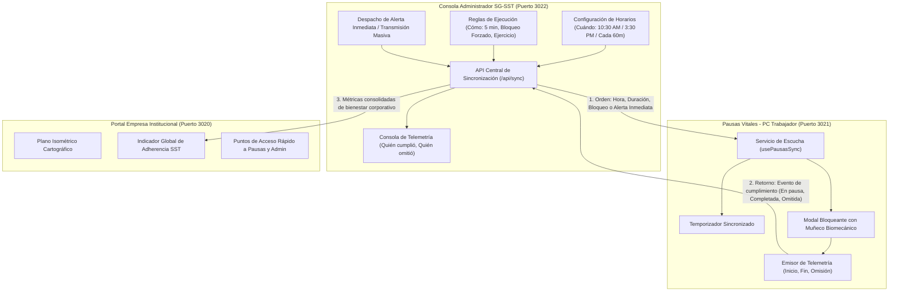

# Arquitectura de Coexistencia y Acoplamiento // Suite SafePulse SST

Este documento define la arquitectura técnica y funcional para la coexistencia de los tres aplicativos de la suite, estableciendo un **acoplamiento bidireccional estricto** entre la **Consola del Administrador SG-SST (`apps/admin-sgsst`)** y el **Portal del Colaborador (`apps/pausas-vitales`)**, con el respaldo informativo del **Portal Corporativo (`apps/portal-empresa`)**.

---

## 1. Visión General del Ecosistema



---

## 2. El Vínculo Rector: Administrador ↔ Pausas Vitales

El administrador es el **director de orquesta** de la jornada ergonómica de la organización. El aplicativo de pausas no opera como un temporizador aislado, sino como una extensión controlada por las políticas de seguridad:

### A. Control Descendente (Admin → Pausas Vitales)
1. **El Cuándo (Programación de la Jornada):**
   - **Horarios fijos:** Pausa matutina (ej. 10:30 AM) y pausa vespertina (ej. 3:30 PM).
   - **Intervalos automáticos:** Cada 45, 60 o 90 minutos de digitación continua frente a pantallas VDT.
   - **Disparo inmediato por comando:** Botón "Lanzar Pausa Inmediata" en la consola que bloquea simultáneamente todas las PCs conectadas en la red.
2. **El Cómo (Parámetros de la Rutina):**
   - **Duración obligatoria:** 3 min, 5 min o 10 min.
   - **Tipo de ejercicio:** Modo aleatorio anti-fatiga o rutina biomecánica específica dirigida a la zona de mayor riesgo (ej. Liberación cervical o Túnel carpiano).
   - **Nivel de exigencia:** Bloqueo de pantalla completa incondicional (Infranqueable) o permiso de posponer por máximo 5 minutos con justificación.
3. **El A Quién (Segmentación Operativa):**
   - Transmisión masiva a toda la empresa.
   - Segmentación por departamento (ej. solo Soporte o Finanzas).
   - Alerta individual personalizada ("Nudge") dirigida a un colaborador específico que lleva horas sin pausar.

### B. Telemetría Ascendente (Pausas Vitales → Admin)
Cada PC reporta en tiempo real su ciclo de vida ergonómico a la consola administrativa:
- **`ACTIVO`**: El trabajador está en su PC dentro del intervalo normal de trabajo.
- **`PROXIMA_PAUSA`**: Faltan menos de 5 minutos para la pausa programada por el administrador (aviso sutil en pantalla).
- **`EN_PAUSA`**: El colaborador tiene el modal activo y está realizando los ejercicios con el muñeco biomecánico (muestra cronómetro en vivo en la consola del admin).
- **`COMPLETADA`**: El trabajador completó el 100% del tiempo reglamentario. Se registra en auditoría: fecha, hora, ejercicio, duración e IP/Puesto.
- **`OMITIDA`**: El colaborador cerró la ventana o no interactuó durante la ventana de tiempo. Se marca en color neutro `#1E293B` para seguimiento del COPASST sin generar sanciones inmediatas.

---

## 3. Especificación Técnica de la API de Sincronización

La API vive en `apps/admin-sgsst` bajo el directorio `src/app/api/pausas/` y expone cabeceras CORS para permitir la interacción segura con `localhost:3021` y `localhost:3020`.

### Endpoint 1: Configuración y Órdenes (`GET` / `POST` `/api/pausas/sync`)
- **`GET /api/pausas/sync`**: Consumido por `apps/pausas-vitales` cada 2 segundos o mediante SSE para obtener el estado actual.
```json
{
  "frecuenciaMinutos": 60,
  "duracionSegundos": 300,
  "forzarPantallaCompleta": true,
  "permitirPosponer": false,
  "horaProximaPausa": "2026-11-19T17:30:00Z",
  "modoPausa": "ALEATORIA",
  "alertaInmediata": {
    "id": "CMD-1732035600",
    "tipo": "EMERGENCIA_ERGONOMICA",
    "mensaje": "Pausa activa obligatoria ordenada por Dirección SST",
    "destinatario": "TODOS",
    "timestamp": 1732035600000
  }
}
```
- **`POST /api/pausas/sync`**: Enviado por la consola del admin cuando el usuario modifica controles o dispara la alarma.

### Endpoint 2: Registro de Eventos del Colaborador (`POST` `/api/pausas/eventos`)
- Enviado por `apps/pausas-vitales` al interactuar con el modal:
```json
{
  "empleadoId": "EMP-01",
  "nombre": "Ana Gómez",
  "departamento": "Soporte",
  "puestoId": "PC-SOP-01",
  "estado": "EN_PAUSA", // o "COMPLETADA", "OMITIDA", "POSPUESTA"
  "ejercicioId": "HOMBROS_ROTACION",
  "duracionSegundos": 300,
  "tiempoRestante": 240,
  "timestamp": "2026-11-19T17:01:15Z"
}
```

### Endpoint 3: Reporte Consolidado (`GET` `/api/pausas/reporte`)
- Entrega al dashboard del administrador el censo en tiempo real de los puestos de trabajo y el porcentaje de cumplimiento para el COPASST (Res. 0312 de 2019).

---

## 4. El Rol del Portal Empresa (Puerto 3020)

El portal corporativo complementa el ecosistema como la **cara institucional y cartográfica**:
1. **Acceso Unificado:** Barra de navegación con accesos directos al aplicativo de pausas (para los puestos de trabajo) y a la consola de administración (para supervisores SST).
2. **Plano Isométrico Cartográfico:** Muestra las 2 estaciones físicas de pausas activas dentro de las instalaciones con indicador de aforo y rutas de evacuación.
3. **Widget de Adherencia en Vivo:** Muestra el cumplimiento global de bienestar de la empresa ("92% de la planta ha cumplido sus pausas activas hoy"), demostrando ante visitantes y entes de control el compromiso real de la gerencia.
