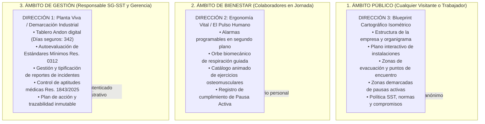

# Dirección Visual y Sistema de Identidad — SafePulse SST

**Versión:** 1.0  
**Fecha:** 2026-11-18  
**Aprobación de Diseño:** Usuario / Product Owner (Punto de Control C)  
**Concepto Rector:** *Sistema Tripartito con Propósito*: cada área del sistema adopta la identidad visual que mejor sirve a su función psicológica y operativa.

---

## 1. El Sistema Visual Tripartito

El proyecto adopta una estructura visual armónica y diferenciada en tres niveles:

---

## 2. Detalle de Cada Ámbito Visual

### Ámbito 1: Portal Corporativo e Institucional (Público) — *Dirección 3: Blueprint Cartográfico*
* **Audiencia:** Visitantes externos, trabajadores, candidatos, auditores y público general.
* **Función:** Transparentar el compromiso preventivo de la empresa, mostrar su infraestructura de seguridad mediante un plano interactivo y divulgar las políticas normativas.
* **Atmósfera y Estilo:**
  * Fondo: Blueprint técnico oscuro `#0B132B` / `#0F172A` con sutil retícula milimétrica de ingeniería (`grid 24x24 px`).
  * Colores de acento: Cian técnico de alta legibilidad `#38BDF8` y `#06B6D4`.
  * Elemento icónico memorable: **Plano Isométrico Interactivo de la Empresa**, con capas alternables:
    * *Capa Verde:* Rutas de evacuación y salidas de emergencia.
    * *Capa Ámbar:* Zonas ergonómicas designadas para pausas activas.
    * *Capa Azul:* Puntos de primeros auxilios y extintores.
* **Tipografía:** **Space Mono** para rotulación técnica, códigos y coordenadas; **Space Grotesk** para párrafos y descripciones de política.

---

### Ámbito 2: Módulo de Pausas Activas ("Pausa Vital") — *Dirección 2: Ergonomía Vital*
* **Audiencia:** Colaboradores de oficina y operarios durante su jornada laboral activa.
* **Función:** Aliviar la fatiga física y mental mediante un oasis visual de calma, ritmo y movimiento corporal consciente.
* **Atmósfera y Estilo:**
  * Fondo: Lino natural y blanco cálido (`#FBFBF9` / `#FFFFFF`), con bordes suaves en salvia desaturado (`#E2E8F0`).
  * Colores principales: Verde Bosque Profundo `#14382A` (estabilidad y vida) y Terracota Cálido `#D96236` (energía humana y pulso).
  * Elemento icónico memorable: **Orbe de Respiración Biomecánico** con animación expansiva rítmica 4-4-4, temporizador circular de descansos y guías ilustradas paso a paso de ejercicios ergonómicos (20-20-20, cuello, muñecas/túnel carpiano y lumbar).
* **Tipografía:** **Outfit** para titulares redondeados y amables; **Plus Jakarta Sans** para instrucciones; **Space Mono** para cuentas regresivas de segundos.

---

### Ámbito 3: Portal del Administrador y Dashboard SG-SST — *Dirección 1: Demarcación Industrial*
* **Audiencia:** Responsable del SG-SST, Coordinadores de Planta, COPASST y Gerencia.
* **Función:** Monitoreo analítico de alta densidad, telemetría de siniestralidad, resolución ágil de reportes de campo y control de estándares legales.
* **Atmósfera y Estilo:**
  * Fondo: Concreto arquitectónico claro `#F4F3EF` con áreas de trabajo en blanco óptico y paneles en carbón grafito `#1A1D20`.
  * Colores de acento: Ámbar industrial de señalización `#D97706` y líneas sutiles de demarcación técnica.
  * Elemento icónico memorable: **Tablero Andon Digital en Tiempo Real** ("DÍAS SEGUROS: 342"), con medidores mecánicos de avance en la Resolución 0312 de 2019 y tarjetas de acción inmediata.
* **Tipografía:** **Space Grotesk** en titulares técnicos condensados; **Plus Jakarta Sans** en tablas y formularios; **JetBrains Mono** en contadores numéricos y radicados (`REP-2026-0042`).

---

## 3. Cohesión Normativa Transversal (Regla Inquebrantable)

En cualquiera de los tres ámbitos, los **Colores de Señal de Seguridad (ISO 7010 / NTC 1461)** mantienen exactamente el mismo valor semántico y **NUNCA** se usan como simple decoración estética:
1. **Rojo Señal (`#DC2626`):** Exclusivo para paradas de emergencia, eventos no conformes graves o estándares en estado crítico.
2. **Amarillo Señal (`#F59E0B`):** Exclusivo para advertencias, exámenes médicos próximos a vencer y riesgos en estudio.
3. **Azul Señal (`#2563EB`):** Exclusivo para obligaciones (uso de EPP, recomendaciones de postura obligatoria).
4. **Verde Señal (`#16A34A`):** Exclusivo para rutas de evacuación seguras, acciones cerradas con éxito y condición "Apto".
