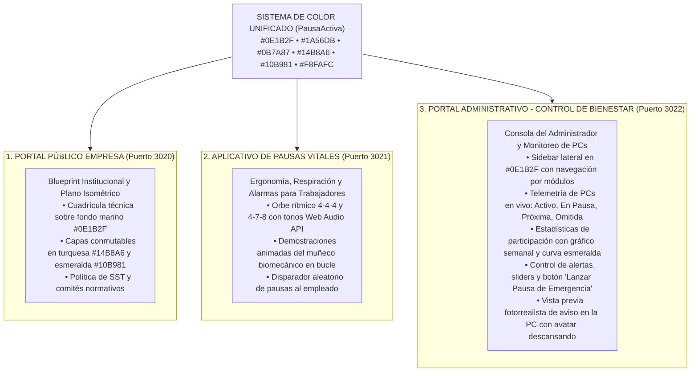

# Dirección Visual y Sistema de Identidad — PausaActiva / SafePulse SST

**Versión:** 2.0 (Sistema de Color Unificado y Portal Administrativo de Bienestar)  
**Fecha:** 2026-11-18  
**Aprobación:** Product Owner / Usuario  
**Concepto Rector:** *Identidad Visual Cohesiva (Verde, Azul y Agua Marina)*. Los 3 proyectos comparten la misma paleta corporativa y cromática, manteniendo su propósito operativo especializado.

---

## 1. Paleta de Colores Unificada de la Suite

```
1. Identidad y Navegación (Primarios):
   ├── Azul Marino Oscuro (#0E1B2F): Sidebar de navegación y textos de alta jerarquía.
   ├── Azul Corporativo   (#1A56DB): Botones y acción principal, enlaces destacados.
   └── Agua Marina Oscuro (#0B7A87): Botones secundarios, pausas de emergencia y avisos armónicos.

2. Enfoque y Énfasis (Agua Marina y Celestes):
   ├── Turquesa / Agua Marina (#14B8A6): Controles activos, interruptores, switches y toggles.
   └── Turquesa Claro         (#2DD4BF): Elementos visuales, relieves y gráficos destacados.

3. Bienestar (Verdes):
   ├── Verde Esmeralda (#10B981): Salud, éxito y la actividad de la "Pausa".
   ├── Verde Menta     (#34D399): Sliders, logros y switches "ON".
   └── Verde Bosque    (#047857): Estadísticas y datos analíticos de participación.

4. Estados de Trabajadores (Monitoreo de PCs en Tiempo Real):
   ├── Azul Enérgico         (#2563EB): "Estado: Activo" (en su PC).
   ├── Verde Esmeralda       (#10B981): "Estado: En Pausa" (cumpliendo la pausa).
   ├── Agua Marina           (#06B6D4): "Estado: Próxima Pausa" (aviso cercano).
   └── Azul Grisáceo Oscuro (#1E293B): "Estado: Omitida" (aviso neutral, sin tono de culpa).

5. Neutros y Fondos:
   ├── Blanco (#FFFFFF): Tarjetas, popups de alerta y contenedores del panel.
   ├── Azul Grisáceo Claro (#F8FAFC): Fondo general de toda la aplicación (anti-fatiga visual).
   └── Gris Azulado (#64748B): Bordes, líneas divisorias y textos secundarios.
```

---

## 2. Los 3 Aplicativos de la Suite con la Paleta Unificada



---

## 3. Arquitectura del Portal Administrativo (`apps/admin-sgsst`)

Inspirado directamente en la guía de UI de referencia:

1. **Sidebar Izquierdo (`#0E1B2F`):**
   * Logo **PausaActiva** en degradado turquesa/esmeralda.
   * Pestañas de navegación: *Dashboard*, *Empleados*, *Configuración de Alertas*, *Biblioteca de Ejercicios*, *Reportes e Historial*.
   * Indicador inferior de sincronización en red y enlaces a los otros dos aplicativos.

2. **Píldoras Superiores de Telemetría:**
   * **PCs Conectadas:** Contador en vivo `254/280` con ícono de laptop.
   * **Cumplimiento Hoy:** Indicador `88%` con anillo circular verde esmeralda.
   * **Próxima Pausa General:** Contador `12:45 min` en cápsula celeste con reloj.

3. **Columna Central-Izquierda:**
   * **Monitoreo de PCs en Tiempo Real:** Tabla con avatares, departamento y badges de estado (`• En Pausa (02:15)`, `• Activo (Trabajando)`, `🌐 Próxima Pausa (3m)`, `• Omitida`).
   * **Estadísticas de Participación:** Gráfico de doble barra semanal (Lun a Vie) con curva continua de tendencia en verde esmeralda `#10B981`.

4. **Columna Derecha (Control y Simulación):**
   * **Configuración de Alertas:** Sliders interactivos de frecuencia (60 min) y duración (5 min), interruptores de forzar pantalla completa, posponer y sonido.
   * **Botón 'Lanzar Pausa de Emergencia' (`#0B7A87`):** Disparo inmediato a todas las PCs conectadas con acorde armónico Web Audio API.
   * **Vista Previa del Aviso en la PC:** Marco de monitor de escritorio con stand que muestra la alerta real con el personaje reclinado descansando hombros y cuello, contador de 5 minutos y botones *Comenzar* / *Posponer*.
