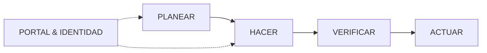

# Épicas del Sistema y Opciones de MVP — SafePulse SST

Versión: 1.0 · Fecha: 2026-11-17

---

## 1. Mapa de Épicas por Ciclo PHVA y Experiencia

### Épica 0: Portal Corporativo e Identidad SST (Transversal / Experiencia)
* **Objetivo:** Comunicar la cultura de seguridad, política institucional, compromisos de la alta dirección y accesos directos al sistema con un diseño distintivo, dinámico y animado.
* **Componentes:** Landing interactiva, sección institucional, manifiesto de prevención, accesos rápidos a pausas y reportes.

### Épica 1: Planear (Estructura y Organización SG-SST)
* **Objetivo:** Establecer la base normativa, política y evaluación de estándares mínimos.
* **Componentes:** Autoevaluación de estándares mínimos (Resolución 0312 de 2019), parametrización de centros de trabajo y comités (COPASST/Vigía).

### Épica 2: Hacer (Gestión Operativa y Salud en el Trabajo)
* **Objetivo:** Proteger activamente la salud y seguridad de los colaboradores en su jornada diaria.
* **Componentes:**
  * **Sistema de Pausas Activas ("Pausa Vital"):** Temporizador inteligente, alarmas en pantalla, ejercicios osteomusculares y visuales guiados con animaciones y contador de descansos.
  * **Control de Conceptos de Aptitud Médica:** Registro seguro de aptitudes y alertas de vencimiento de exámenes ocupacionales periódicos (Res. 2346/2007).

### Épica 3: Verificar (Inspección, Eventos e Indicadores)
* **Objetivo:** Detectar desviaciones, reportar incidentes oportunamente y medir el desempeño.
* **Componentes:**
  * **Reporte Ágil de Incidentes y Condiciones Inseguras:** Formulario móvil para colaboradores y testigos con evidencia fotográfica y georreferenciación.
  * **Tablero Gerencial de Indicadores:** Visualización interactiva de accidentalidad (Frecuencia, Severidad, Proporción de incidentes cerrados) y cumplimiento de estándares.

### Épica 4: Actuar (Mejora Continua y Hallazgos)
* **Objetivo:** Cerrar el ciclo mediante planes de acción concretos.
* **Componentes:** Gestor de hallazgos con responsables asignados, fechas límite y semaforización de cumplimiento.

---

## 2. Opciones de MVP y Recomendación

### Opción A — "Mínimo Burocrático" (Desaconsejada)
* **Alcance:** Formulario simple de autoevaluación Res. 0312 y registro básico de incidentes en tabla plana.
* **Compromisos:** Carece del impacto visual y de las animaciones requeridas; no soluciona el dolor del cliente sobre el sedentarismo y las pausas activas; bajo compromiso de los trabajadores.

### Opción B — "Experiencia Preventiva y Cumplimiento" (RECOMENDADA)
* **Alcance:**
  1. Portal corporativo público interactivo con animaciones de identidad preventiva y política SST.
  2. Módulo de pausas activas ("Pausa Vital") con alarmas programables, rutinas animadas y métrica de cumplimiento.
  3. Reporte de incidentes en celular/escritorio con carga de fotos y persistencia local sin conexión.
  4. Tablero interactivo SG-SST con semáforo de estándares mínimos (Res. 0312) y gráficos de accidentalidad.
  5. Registro seguro de conceptos de aptitud médica y recomendaciones laborales (cumpliendo privacidad Res. 2346).
  6. Plan de acción para hallazgos con responsables y fechas límite.
* **Justificación:** Cumple al 100 % con el requerimiento estrella del cliente (alarmas y pausas activas), asegura un frontend espectacular, interactivo y accesible, y cubre los pilares legales fundamentales del SG-SST colombiano sin sobrecargar de complejidad el primer ciclo.

### Opción C — "Suite Enterprise PHVA Completa" (Desaconsejada para MVP inicial)
* **Alcance:** Incluye matriz GTC 45 con las 40 clasificaciones de peligro, módulo de gestión documental con control de versiones ISO, portal de contratistas con validación de aportes a PILA/seguridad social y plan de emergencias con planos CAD.
* **Compromisos:** Tiempo de desarrollo prolongado; alta dispersión del foco en burocracia documental en lugar de un frontend refinado y usabilidad de campo.

---

## 3. Decisión
Se selecciona la **Opción B — Experiencia Preventiva y Cumplimiento** como la base del MVP de SafePulse SST.
